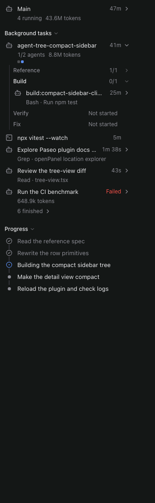
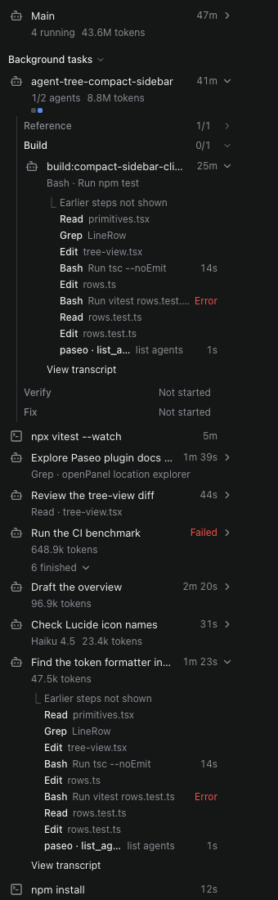

# Agent tree for Paseo

A [Paseo](https://paseo.sh) plugin that shows, live, everything a Claude Code agent runs under it, in the style of the Claude Code desktop app's subagent sidebar:

- **Workflow runs** with their phases and agents
- **Agent tool subagents** and background agents
- **Background shell commands**
- the **todo list**

Each row shows what the agent is doing now, its status, its elapsed time and its tokens. Press an agent to see its last tool calls in place, or open its transcript: prompt, every step with input and result, tokens (input, output, cache read, cache write, context) and final answer.

 

<sub>Previews rendered with mock data outside the Paseo app.</sub>

## Install

```bash
paseo plugin install github:Lanioque/paseo-agent-tree
```

Requires Paseo 0.14.0 or newer on the daemon and on each connected app. Plugins must be enabled on the daemon (Settings → Plugins).

## Use

Open it on any Claude Code agent from the Command Center (**Open agent tree**), the `/agent-tree` slash command or the **Agents** pill in the composer. It opens in the Explorer (the right sidebar) and can also be moved to a workspace tab. The **Agent runs** screen (sidebar, or **Open agent runs** in the Command Center) lists the Claude Code sessions active in the last 24 hours.

## What it reads

Read-only, local files on the daemon's machine: the Paseo agent records in `$PASEO_HOME/agents` (default `~/.paseo`) and the Claude Code transcripts, subagent and workflow files in `$CLAUDE_CONFIG_DIR` when set, plus `~/.claude` and `~/.config/claude`. It writes no file, starts no process, makes no network call and calls no model. Text is masked before it reaches the app (card, IBAN, ID and account numbers, API keys, tokens, passwords) and your home directory is shortened to `~`. See [OVERVIEW.md](OVERVIEW.md) for the details.

Statuses come from Claude Code's own records (workflow journals, tool results, task notifications). Without one, an agent that wrote nothing for 30 minutes is shown as stopped. Checked against the file formats of Claude Code 2.1.299 to 2.1.308.

## Develop

```bash
npm ci
npm run typecheck
npm test
# Optional: run the read-only live test against one of your agents
AGENT_TREE_LIVE_AGENT_ID=<paseo agent id> AGENT_TREE_LIVE_RUN_ID=<wf_… run id> npm test
# macOS: compile with the compiler shipped in Paseo.app
npm run compile-check
paseo plugin install "$PWD"   # then: paseo plugin reload paseo-agent-tree
```

Layout: `server/` reads the transcripts incrementally (only the bytes added since the last poll), `client/` is the React Native UI, `shared/contract.ts` holds the RPC contracts.

## License

MIT
